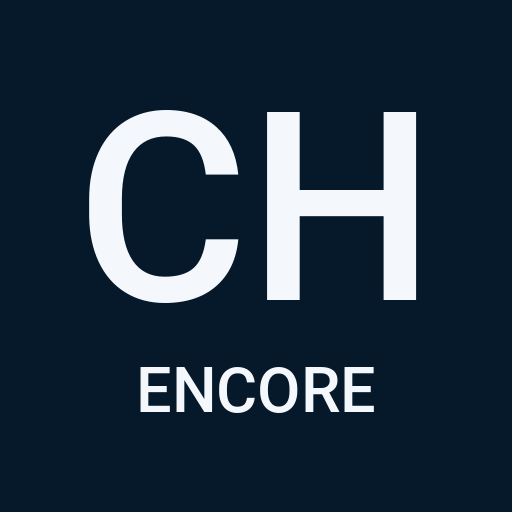

# CH: Encore — PS5

Huge thanks to my cousin, [Eddie Rubio](https://music.youtube.com/channel/UCmQMUczMFC3UQH1eaTNe1Bw), for the awesome main menu riff.

A native PS5 rhythm game with guitar/bass, drums and local multiplayer.

**v1.5.1 — Personal install builder** moves asset setup onto your PC. The public download contains an asset-free game template and a desktop builder. Your own authorized PC resources are added locally to a folder install, exFAT image or native homebrew PKG. No original PC resources or songs are supplied by this project.

## Getting started

1. Download and extract the **desktop-builder ZIP** from [Releases](https://github.com/MyNameIsAwoo/CHEncore-PS5/releases).
2. Run **Start-Builder.cmd** on Windows (Python 3.10+), or **Start-Builder.sh** on Linux/macOS.
3. Select a detected PC installation or Browse to yours, choose an output folder and install format, then select **Build install**. Only the fingerprinted resource version supported by the importer is accepted.
4. Install your generated folder/image/package with your compatible PS5 homebrew setup. Its included personal assets are prepared automatically at first launch—no separate console asset transfer is needed.
5. Add your own authorized charts through Encore Browser, `/data/homebrew/SONGS`, or an exFAT root-level `SONGS` folder. Nested collections are supported.

Read [Asset setup](docs/ASSET_SETUP.md) for requirements and supported platforms. Generated personal installs contain your imported resources and must stay private. Only the unmodified public builder is shareable. No permission to extract/reuse the original resources or developer approval is claimed; see [rights and distribution](docs/RIGHTS_AND_DISTRIBUTION.md).

Already imported assets, songs, profiles and scores remain in persistent storage, outside code/runtime updates. Existing installations can continue using normal in-game updates without rebuilding.

## Features

- Five-fret guitar/bass, six-fret, drums, Pro Drums and five-lane layouts.
- Up to four local players, profiles, per-instrument remapping and controller navigation.
- Encore Browser for chart search/downloads; USB/internal song scanning, copying and confirmed removal.
- Local records, lyrics, solos, pause/restart, previews and highway/color options.
- Display-aware resolution and supported 60/120 FPS modes.
- USB MIDI drums with **experimental/intermittent support**; keep a DualSense for menus and pause.
- Verified updates with persistent user resources and startup recovery.

## Updating

Existing installations keep their imported resources through the normal in-game runtime update. Older clients can first receive the v1.5.0 migration from the retired repository address; future checks then use this repository. For a fresh install, use the desktop builder. Original PC assets are never downloaded by the updater.

The game-folder, exFAT and native homebrew/debug PKG formats are supported by compatible homebrew setups. These packages are not retail-signed. Preserve the complete title folder and your userdata when manually installing.

## Status and rights

This remains a work in progress. Physical four-instrument, five-lane, six-fret and MIDI testing needs broader reports. The reported RB4 Stratocaster problem still needs a tester log/retest. Online play, whammy and tilt are unfinished. PS4/Switch ports have no release date.

This project is not affiliated with, approved by or endorsed by the original PC developers. Supplying your own files does not itself grant permission to extract, modify or reuse them. The project does not claim that changing its name or removing its assets resolves all copyright, contractual or anti-circumvention questions. See [rights and distribution notes](docs/RIGHTS_AND_DISTRIBUTION.md).

## Building and reports

Native builds use the vendored prospero toolchain and the existing Vulkan 1.3/RADV renderer. See `ps5/README.md`, the corresponding-source archives, and `BUILDING.txt` in each release. Personal resources are never native code build inputs or public release attachments. The desktop builder adds them only to the user's private install output.

Read [known issues](KNOWN_ISSUES.md) and [diagnostics](docs/beta-diagnostics.md) before reporting a problem. Include console/firmware, launcher/version, controller/mode and reproduction steps. Discord: **mynameisawooo**.

## Credits and licences

Native code and third-party components retain their individual licence notices. The linked executable and corresponding source follow their applicable combined-work obligations. The asset importer contains metadata and code, not the original PC assets. Roboto, dependency certificates and user-supplied main-menu audio retain their stated licences/rights.

PlayStation and PS5 are trademarks of Sony Interactive Entertainment Inc. This is an independent homebrew project.
